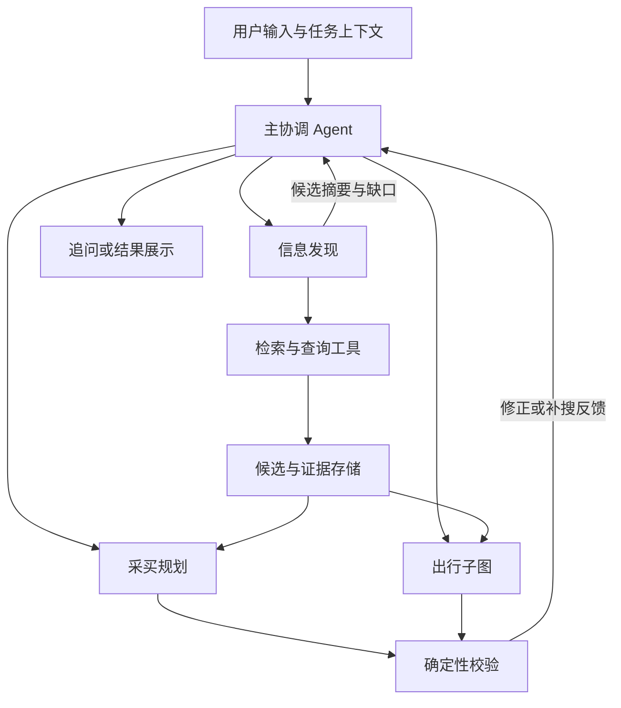

# Agent 分类与协作设计

- 更新日期：2026-11-02
- 状态：对话设计结论与实现基线，尚未实现；后续按编号任务逐步验证
- 整理时仓库基线：`8459e407f890061045dcb53b03ef98168cc656c8`
- 相关：[Agent 执行与预算](agent-execution-rules.md)、[意图识别](intent-routing.md)、[Tools 与 MCP](tools-and-mcp.md)、[RAG](rag-and-retrieval.md)
- 本文是设计参考，不授权一次性实施全部能力；当前代码与验收状态见 [进度](../progress.md)

## 1. Agent 的种类与业务分工分开讨论

| 维度 | 类型 | 在本项目中的含义 |
| --- | --- | --- |
| 运行机制 | 工具调用型 / ReAct | 根据目标和工具结果反复决定查询、计算、追问或回答 |
| 运行机制 | 规划执行型 | 形成计划，执行后按结果修正，适合复杂采买和出行 |
| 协作方式 | 主协调与专业 Agent | 主 Agent 维护对话与任务上下文，委派专业能力并汇总 |
| 编排方式 | 固定工作流 | 处理确定性步骤，例如文件解析、发布后索引；不一定需要 Agent |

这些维度可以组合，不是互斥的框架选项。意图识别、查询改写、预算计算、检索、会话标题等，不因使用模型或名称带 Agent 就必须建立独立 ReAct Agent。

## 2. 首版职责划分

采用三个 Agent 职责加一个出行规划子图；不为每类商品建立独立 Agent，也不为每个 Agent 部署独立服务。

| Agent / 模块 | 决策职责 | 输入与输出 |
| --- | --- | --- |
| 主协调 Agent | 理解目标、关联任务、补充条件、委派与汇总 | 用户消息和任务摘要 → 路由、委派、追问、最终回复 |
| 信息发现 Agent | 选择来源、检索、补搜、去重、记录缺口 | 检索目标和条件 → 候选、证据、未知项 |
| 采买规划 Agent | 比较候选、组织组合、安排数量、请求补搜与修正 | 条件和候选引用 → 结构化方案、预算明细 |
| 出行规划子图 | 交通住宿选择、每日安排、时间费用检查、关联任务 | 出行条件和候选 → 行程、费用、关联美食采买任务 |
| 确定性校验模块 | 金额、数量、时间、位置、引用及版本检查 | 方案和约束 → 通过或问题清单；通常是代码而非 Agent |

教师奖品、衣物、二手、饮品和经营采购通过场景条件、工具子集和规划策略承接。出行不是唯一业务；美食、本地发现、经营采购等完整范围继续保留。

仅当一个领域的工具、上下文或业务规则明显不同，且评估表明现有职责难以处理时，再拆新的专业 Agent。拆分依据是职责与效果，而不是 Agent 数量。

## 3. 按需协作

图表示允许的关系，不要求每次遍历全部节点。查询附近夜宵可能只需发现；奖品组合通常需要发现、规划和金额检查；杭州三日游与伴手礼需要出行和采买关联。

补搜和修正由结果驱动：例如候选不足、预算冲突、资料缺失，再决定继续查询、调整方案或询问用户。总调用次数、执行轮数和截止时间由共享运行预算约束，不能只写在提示词里。具体数值在执行任务中配置并通过评估调整。

专业 Agent 返回结构化结果与必要摘要；主协调统一组织用户回复。用户可见进度显示查询结果、检查结果和等待事项，不输出模型内部推理过程。

## 4. 共享任务数据与隔离上下文

- 会话承载消息；任务承载独立目标；任务版本保存条件快照；run 表示一次执行。继承初始设计包的对象划分。
- 采买、旅游、经营采购的预算、位置和状态分别保存。当前所在地、搜索中心和目的地不互相覆盖。
- 委派传递当前任务版本、必要条件、候选和证据 ID；不默认把整段聊天与全部工具输出塞给每个子 Agent。
- 用户身份由后端认证后注入，不由模型选择；任务 ID 和候选 ID 在服务端检查归属、可见性与版本。
- 正式方案、候选、任务状态独立持久化，不仅保存在聊天文字或图检查点中。
- Worker 与 API 使用同一 Python 工程；多 Agent 职责不等于多进程或多服务。

## 5. 方案计算与检查

模型可以解释用途、比较偏好、提出组合和修复建议；总金额、数量、时间冲突、候选引用与硬条件由代码复核。

校验失败后输出具体问题和受影响候选，规划模块再修正。主观评价可以作为辅助信号，不能覆盖明确的预算、权限或时间冲突。未知报价或营业信息保留未知，不推断为已经满足条件。

## 6. 出行模块的实现边界

Python 的 `agents/travel/` 负责规划；Java 的 `travel-mcp/` 模拟外部交通酒店查询。后续其他 MCP 服务也沿用通用接入层。系统当前目标是推荐与规划，预订和支付保留为扩展。

出行开发前先形成 GoGo 能力对照和本项目实现任务，明确借鉴策略、可复用代码及需要重新实现的部分。目前没有直接搬入或重新实现整个 GoGo。

## 7. GoGo 参考范围

对照固定提交 [d7823df](https://github.com/wmy-me/gogo-agent/tree/d7823df02887b01e31ffa094d06ab22653876098)，不将其当作后续所有版本的行为：

- [MasterAgent](https://github.com/wmy-me/gogo-agent/blob/d7823df02887b01e31ffa094d06ab22653876098/src/main/java/com/gogo/travel/agent/MasterAgent.java)委派差旅管理、行程规划、信息查询和预订等能力。
- 规划使用结构化候选与计算工具，避免仅从压缩聊天记忆重新猜测方案。
- [ObjectiveReviewEngine](https://github.com/wmy-me/gogo-agent/blob/d7823df02887b01e31ffa094d06ab22653876098/src/main/java/com/gogo/travel/agent/tools/review/ObjectiveReviewEngine.java)包含完整性、时间、起终点、预算、交通和路线等代码检查。
- 信息与规划职责可参考，但企业审批、预订、报销不作为当前生活采买主线的必备实现。

本项目采用 Python / LangGraph 的数据与执行模型，具体复用范围需要逐项评估，不能把 GoGo 的 Bean 数量、类名或提示词约束直接当成本项目的能力和强制运行规则。

## 8. 落实顺序

002 标准 MCP 联调与 003 最小工具调用循环均已提交。P2 从 004 登录认证开始，再建立任务上下文和持久化；P3 围绕奖品采买建立上述职责协作。RAG 与出行分别按相应阶段落地。LangGraph 已安装不代表已经实现多 Agent。

参考：[LangChain Subagents](https://docs.langchain.com/oss/python/langchain/multi-agent/subagents)。

## 9. 012 后续执行规则

012 已实现单次购物主从委派，尚未实现本图的规划、补搜、修正与出行子图。后续具体 ReAct 角色、共享轮次/工具预算、停止和恢复策略以[Agent 执行与预算规则](agent-execution-rules.md)及对应编号任务为准；本文的职责关系不表示所有节点已存在。
