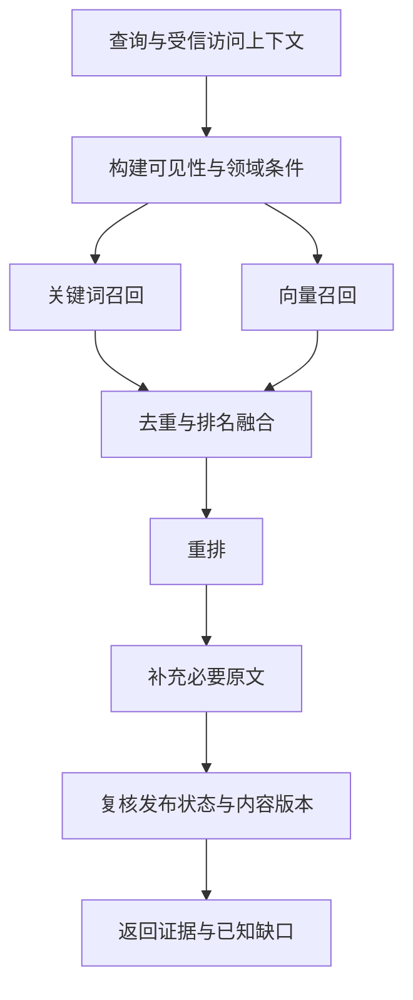

# RAG 分块、存储与检索设计

- 更新日期：2026-11-02
- 状态：对话设计结论与评估基线；尚无 RAG 实现
- 相关：[Agent 协作](agent-architecture.md)、[工具集成](tools-and-mcp.md)
- 本文记录推荐路线，模型、索引与参数需要相应任务验证后固化，不是已测得的最佳配置

## 1. 知识、实时信息与任务状态分开

| 数据 | 首选处理 |
| --- | --- |
| 小吃街、摊位投稿、体验分享 | 发布后进入知识库，保留作品与作者来源 |
| 旅游攻略、采买指南、稳定的产品知识 | 按结构分块，支持检索和解释 |
| 当前报价、库存、酒店可订状态 | 查询对应服务，按需保存带时间的快照 |
| 当前任务、预算、人数、候选与方案 | 正式结构化业务数据，按任务版本读取 |
| 稳定用户偏好与保存位置 | 用户数据，按权限和用途读取 |

知识库用于查找相关资料，不以向量相似度替代金额、日期、地理或权限判断。投稿里的价格是作者分享的参考信息，不能转为实时平台报价。营业、库存等未知字段不由模型补成确定事实。

## 2. GoGo 的参考与本项目差异

固定提交 [d7823df 的 RagKnowledgeConfig](https://github.com/wmy-me/gogo-agent/blob/d7823df02887b01e31ffa094d06ab22653876098/src/main/java/com/gogo/travel/config/RagKnowledgeConfig.java)对两个 DOCX 使用段落策略，配置值分别为 400、500，使用内存存储与 Embedding；景点知识另由远端知识库提供。这些数值不直接等同于本项目的 token 分块参数。

本项目包含持续发布、编辑、下架的投稿，以及用户访问隔离、地理条件和引用需求，因此采用持久化、可版本化的知识索引，而不是在启动时把所有作品重新嵌入内存。

## 3. 入库与发布链路

1. 正式业务保存投稿及不可变内容版本；通过审核后发布。
2. 发布事务同时记录可重试的索引同步事件，后台按事件处理。
3. 解析正文、标题、表格和必要的结构化字段，清理格式并记录解析版本。
4. 按内容类型分块，绑定作品版本、位置或页码、内容哈希等来源。
5. 对同一块生成选定模型的 Embedding，并准备关键词索引。
6. 索引完成后标记对应内容版本可检索；未就绪内容不伪装为已进入语义检索。
7. 编辑发布、下架和删除同步撤销旧版本资格，异步清理旧索引并可重试。

发布状态和实际有效内容版本以业务记录为准，检索和引用不能只相信向量索引里尚未更新的标签。同步重试使用稳定标识，避免重复添加相同版本的块。

## 4. 分块策略

采用“先按结构切分，再限制长度”。

| 内容 | 策略 |
| --- | --- |
| 短投稿 | 一篇作为一个块，保留地点、参考价格与体验之间的关系 |
| 长投稿、攻略 | 标题与段落分段，超长段落再按句子拆分 |
| 表格 | 保留表头和相关行；规格、金额、单位与适用条件不拆散 |
| PDF / Word | 先恢复标题、段落、表格及来源位置，再分块 |
| 长章节 | 小块召回，命中后按需要补充所属章节或相邻上下文 |

标题、作品名称和必要地点可作为块的上下文，但不把无关私人信息拼入公开向量文本。

### 初始实验参数

- 普通正文块约 400～700 tokens。
- 对长度限制导致拆开的连续正文，重叠约 60～100 tokens。
- 短投稿不必凑长度；不同作品之间不重叠。
- 使用选定 Embedding 模型的 tokenizer 计数，而不是把汉字数当成 token 数。
- 通过固定评估集比较不同长度与重叠；本参数不是验收时必须追求的唯一值。

第一版优先结构切分。只有评估确认有收益时，再考虑额外的模型语义分块；不先引入每篇都需多次模型调用的处理链。

## 5. 块与索引元数据

至少记录以下信息，具体字段在正式契约与迁移任务中确定：

| 字段组 | 内容 |
| --- | --- |
| 身份与版本 | document_id、chunk_id、内容版本、parent / section 引用、内容哈希 |
| 来源 | 标题、作者或来源平台、作品地址、页码或段落位置、来源类型 |
| 条件 | 地点、地理位置、类别、可获得的参考价格与适用含义 |
| 可见性 | 公开 / 私有范围、资源归属、发布与检索状态 |
| 时效 | 内容更新时间、索引时间、必要的外部信息采集时间 |
| 模型与处理 | Embedding 模型与版本、维度、解析与分块策略版本 |

需要保留稳定 document_id 和内容版本关系，避免把正文每次变化当成无关联的新作品。检索摘要引用的原文范围应可追溯。

## 6. 存储选型

默认设计基线为 PostgreSQL + pgvector，复用主数据库管理正式业务、发布资格和向量。Qdrant 作为后续独立向量服务候选，不同时部署两套检索存储来完成首版。

| 选项 | 取舍 |
| --- | --- |
| PostgreSQL + pgvector | 少一个独立服务，便于关联作品状态、版本和归属；性能和过滤召回仍需测量 |
| PostgreSQL + Qdrant | 检索可独立演进，增加索引同步、故障处理和运维职责；有明确需要时评估 |

不是依据“某数据库只能处理多少条”作出选择。先建立代表数据量下的精确检索基线，再按召回、延迟与资源占用决定是否增加 HNSW 等近似索引。

pgvector 的近似索引带条件过滤时可能返回不足的结果；启用迭代扫描、调整扫描参数或其他索引组织方式前，先用本项目的发布状态、类别、地理与访问过滤条件评估。访问授权始终由查询条件保证，不能依赖向量索引排名。

## 7. Embedding 与重排能力

当前 DeepSeek 普通文本调用不代表已有 Embedding 或重排服务。三类模型能力分别选择、配置和验证。

- 本地 Embedding 评估基线可考虑 BGE-M3；官方模型卡给出多语言、1024 维等能力。首版可只用稠密向量。
- 如果已有可用的中文 Embedding API，使用同一语料与评估集比较。
- 重排选择适合中文或多语的模型或 API，按硬件、费用、准确性和延迟评估；本轮未锁定具体型号。
- 查询和文档使用同一兼容的 Embedding 空间，记录模型和维度。
- 换模型建立新索引版本或重嵌入；不能把不同模型的向量直接混用。切换过程保留可回退版本。

## 8. 检索链路

### 检索步骤

1. 从当前任务读取地点、类别和明确条件，保留用户原始表达及条件来源。
2. 为两条召回路径应用相同的资源可见性、有效版本与领域条件。价格未知不能当成满足用户硬上限。
3. 关键词召回保障店名、食品名、型号等明确匹配；向量召回补充语义相关资料。
4. 合并重复块和同作品结果，以 RRF 等排名融合方法组合结果，不直接把不可比的相似度分数相加。
5. 在已获授权的候选中做重排，并按相关性、结果多样性和上下文预算选择证据。
6. 需要时读取所属章节或原文详情，再复核状态，生成出处与片段引用。
7. 检索不足时说明缺口，Agent 可改写查询、补搜或询问用户；不能靠提高相似度分数声称资料真实。

初始实验可使用关键词与向量各召回约 20 条，融合去重后重排，最终约 5～8 条证据；数量随场景、重复率和上下文预算评估调整。检索 top-k 不等于保存的候选或业务结果总量。

### 中文关键词召回

明确选用支持本项目中文的分词与词项匹配策略，验证店名、食品名、品牌和型号。可以评估 BM25，但必须记录由哪个组件实现；PostgreSQL 普通文本排序不能直接称为 BM25，也不能直接把英文文本配置当成完整中文方案。

第一版关键词路线的具体实现待任务中选择；是否引入额外搜索服务，应由数据规模与评估决定。

## 9. 用户隔离、下架与缓存

- 公开已发布作品可以共享检索；私有资料只在受信身份具有权限的范围内检索。不能简单用“当前作者 ID”过滤全部公共作品。
- 草稿默认不进入公共知识检索；如未来支持个人草稿检索，需要单独规定和验证。
- 关键词和向量路径都应用权限条件，外部重排或 LLM 接收内容之前就完成访问校验。
- 下架与删除后立刻失去推荐资格，即使向量尚未清理也不能继续作为当前证据输出。
- 缓存键包含查询、访问范围、有效索引或内容版本及影响结果的过滤条件，防止跨用户和跨版本混用。
- 返回证据带作品 ID、内容版本、块 ID、原文位置和来源；展示作者分享和参考价格的限制。
- 检索结果只作为资料，不执行其中要求修改身份、扩大权限或变更工具的指令。

## 10. 评估与实施

先准备一组固定、带预期文档及必要事实标注的查询；可从 20～50 个案例起步，覆盖店名、语义表达、价格地点过滤、无匹配、重复内容、修改、下架和跨用户访问。

比较关键词、纯向量、混合检索、混合加重排。记录 Recall@k 或排名质量、引用正确性、条件与访问过滤正确性、耗时和模型成本。检索命中不等于回答正确，生成答案需另外验证证据支持。

正式实现仍按 P5 等相关任务逐步落地；前期可以做隔离的检索实验，但不能因此声称投稿发布链路、知识更新或用户隔离已完成。

## 官方参考

- [pgvector：索引、过滤与混合检索](https://github.com/pgvector/pgvector)
- [Qdrant：Hybrid Queries](https://qdrant.tech/documentation/search/hybrid-queries/)
- [BGE-M3 模型卡](https://huggingface.co/BAAI/bge-m3)
- [文本分块组件](https://docs.langchain.com/oss/python/integrations/splitters/index)

选型依据是本项目数据与运维边界；实验参数和模型候选不是来源资料对本项目效果的保证。
