# 生活采买智能体：项目初始设计包

> 这是初始设计参考。Java 目前按模拟外部 MCP 的测试服务定位，具体能力通过通用客户端接入；最新口径见 [项目定位](../overview/project.md)。第 15 节目录和第 19 节任务属于早期建议，实际目录以仓库为准，当前执行任务只从 [AI 任务目录](../vibe%20coding/README.md) 按用户本次指令选取，勿直接执行本设计包的后续阶段。

> Agent 分类、Tools 与 MCP、RAG 和意图识别的后续讨论已整理为 [专题设计](README.md)。涉及这些主题时结合专题阅读；本文保留早期总体设计，不视为当前全部实现状态。

**对应课题：基于大语言模型与 MCP 的多场景生活服务智能体系统设计与实现**  
**设计日期：2026-11-02**  
**依据：用户本次提供的《生活采买智能体_课题项目计划书.md》当前全文**  
**状态：可用于项目初始化和任务拆解的设计初稿；尚未创建代码、数据库或可运行服务。**

本文把计划书转换为启动开发所需的系统边界、架构、流程、数据模型、协议和验收标准。推荐的模块名、字段、接口路径和预算参数是初始设计建议，不代表已经存在的实现，也不预设现有 Java 项目的内部结构。具体依赖版本在最小兼容性验证后锁定。

## 1. 开发前需要准备什么

| 初始材料 | 解决的问题 | 本设计包位置 | 何时需要细化 |
| --- | --- | --- | --- |
| 范围与角色权限表 | 本期做什么，各角色能操作什么 | 第 2 节 | 建仓前 |
| 总体架构图 | 网页、Python、Agent、Java MCP 和数据如何连接 | 第 3 节 | 建仓前 |
| 部署结构图 | 哪些是模块，哪些实际启动为进程或容器 | 第 4 节 | 骨架阶段 |
| Agent 职责与协作图 | 谁负责理解、检索、规划、检查 | 第 5 节 | 首条 Agent 链路前 |
| 用户任务流程图 | 追问、补搜、修改和失败怎么处理 | 第 6 节 | 首条 Agent 链路前 |
| 任务状态机与恢复规则 | 刷新、取消、进程崩溃后怎么继续 | 第 7 节 | 首条可恢复链路前 |
| SSE 时序图 | 后台执行和前端展示如何配合 | 第 8 节 | 前后端联调前 |
| 投稿与知识库流程图 | 内容审核、检索和失效如何同步 | 第 9 节 | 投稿模块开发前 |
| ER 图与数据字典初稿 | 业务状态、候选、来源和方案怎么保存 | 第 10 节 | 第一批迁移前 |
| REST、MCP、卡片与事件协议 | Python、Java、React 的交接约定 | 第 11—13 节 | 多模块联调前 |
| 页面和目录结构 | 前后端代码从哪里开始写 | 第 14—15 节 | 建仓前 |
| 环境、演示数据和评估用例 | 如何启动、如何证明完成 | 第 16—18 节 | 骨架及后续各阶段 |
| 首阶段任务与验收清单 | 第一批具体交付是什么 | 第 19—20 节 | 立即可执行 |

这些材料是设计起点。第一批迁移只覆盖当前开发阶段实际使用的数据表，其余模型随功能推进细化。

## 2. 范围、角色与初始约定

### 2.1 按当前计划书确定的实施范围

| 范围 | 本期设计与实现目标 | 扩展关系 |
| --- | --- | --- |
| React 网页 | 优先交付用户功能与管理页面 | 后续 Android 复用业务接口 |
| Python 主后端 | 账号、会话、任务、Agent、投稿、知识、推荐方案与行程 | 同一个工程按模块组织 |
| 三类 Java MCP | 购物采买、出行信息、本地生活外卖的搜索与详情 | 保留三个服务，逐个联调 |
| 采买情景 | 教师奖品、日用品、聚会采购、天气衣物、二手、美食饮品、经营采购 | 情景通过条件与规划策略表达 |
| 旅游与出差 | 交通、酒店、每日安排、费用估算，与美食和采买联动 | 独立规划子图；是否适配 GoGo 待核对源码与协议 |
| 小吃街知识库 | 投稿、审核、发布、搜索、引用、修改和下架同步 | 图片先作为作品展示，正文与结构化字段参与检索 |
| 文字、位置、语音 | 网页先做文字和手动位置，再接定位与语音转文字 | Android 后续接原生定位和录音 |
| 交易衔接 | 在方案中保存来源、平台标识、规格、数量和价格依据 | 后续增加结算、用户确认、模拟订单与模拟支付 |

**本期平台工具用于查询。下单、预订、支付、退款等能力在扩展阶段接入。** 投稿保存、收藏、偏好修改等主系统业务由受权限控制的业务接口完成。

### 2.2 角色权限初稿

| 角色 | 可用范围 | 服务端校验重点 |
| --- | --- | --- |
| 普通用户 | 自己的会话、任务、方案、行程、偏好与收藏；已发布作品 | 资源所属用户与发布状态 |
| 内容投稿者 | 普通用户能力；创建及修改自己的投稿 | 作者归属、当前内容版本、提交状态 |
| 内容审核员 | 投稿审核、退回与下架 | 审核权限、操作对象、审核记录 |
| 模拟商家或卖家 | 自己的店铺、商品、SKU、二手或菜单数据 | Java 服务校验资源归属和受信用户身份 |
| 管理员 | 用户角色、模拟数据、工具配置、索引任务等管理 | 明确权限、变更校验和审计 |

教师、消费者、经营者是任务用途，不增加三套用户系统。一个账号可以同时具备普通用户、投稿者等身份。

### 2.3 启动时采用的建议默认值

- 一个代码仓库组织 React、Python 和 Java 子项目，便于毕设联调与部署。
- Python 采用模块化单体，同一份代码提供 API 和后台 Worker 两个启动入口。
- 主协调、信息发现、采买规划是三个 Agent 职责；旅游使用专门子图。无需给每类商品单独建立 Agent，也无需给每个 Agent 独立部署服务。
- 第一条完整业务选择“教师奖品采买”；其余情景继续保留，按依赖推进。
- PostgreSQL 先承担业务持久化与任务队列。图片使用存储适配接口；开发环境可用持久卷目录，部署时可换兼容对象存储的实现。
- pgvector 在投稿检索阶段启用；Redis 在缓存或限流确有需要时加入。恢复和数据正确性依据 PostgreSQL 中的正式记录。

## 3. 系统总体架构图

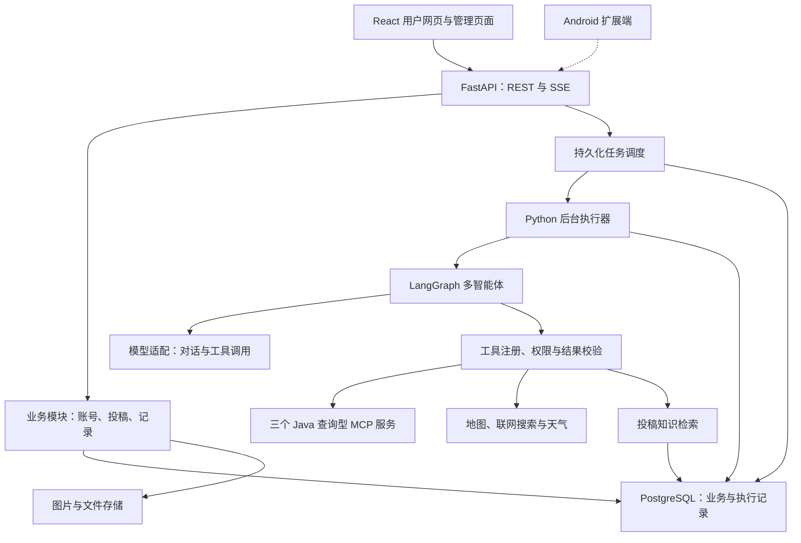

### 3.1 边界分工

| 部分 | 负责 | 数据所有权 |
| --- | --- | --- |
| React | 页面、输入、地图和结构化卡片、事件重连 | 服务器正式数据的展示与临时输入 |
| FastAPI 业务模块 | 登录权限、投稿审核、收藏、偏好、方案查询等 | 主系统业务数据 |
| Python Agent 模块 | 理解需求、任务拆分、委派、检索、规划、校验、汇总 | 任务、执行记录、候选、证据与方案 |
| Python Worker | 领取任务、运行 Agent、索引同步、恢复与取消检查 | 任务执行权与持久化结果 |
| Java 购物采买服务 | 商城与二手查询；对应目录维护 | 店铺、商品、SKU、卖家、二手信息 |
| Java 出行信息服务 | 模拟交通、酒店查询；对应目录维护 | 交通与酒店目录 |
| Java 本地生活服务 | 门店、菜单、口味、规格查询；对应目录维护 | 外卖与本地生活模拟目录 |
| 外部服务 | 公开地图、天气、网络资料等 | 原始外部信息；主系统保存必要来源快照 |

Java 目录管理通过独立的受控管理接口完成。查询型 MCP 只暴露读能力。后台页面可经 Python 管理接口转交 Java 管理接口，Java 端再次检查服务身份和资源归属。

### 3.2 数据库边界

开发环境可共用一个 PostgreSQL 实例，并划分 `app`、`agent_checkpoint`、`commerce`、`travel`、`local_life` 等 schema 和数据库角色。Python 与各 Java 服务负责自己的迁移，通过接口交换数据。主系统保存 Java 返回的外部资源标识和必要快照。

用户、会话、任务等业务查询以业务表为准。LangGraph checkpoint 用于执行恢复；它与长期偏好、正式方案分别管理。这对应 LangGraph 官方对线程检查点与跨线程存储的职责区分。[1][2]

## 4. 开发部署结构图

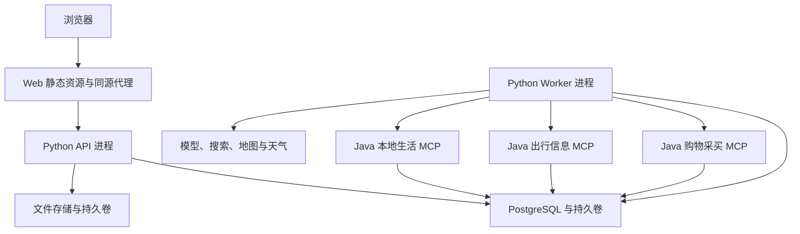

| Compose 服务建议名 | 是否首阶段启动 | 职责 |
| --- | --- | --- |
| `web` | 是 | React 构建产物、同源 API 和 SSE 代理 |
| `api` | 是 | REST、身份认证、业务操作、事件订阅 |
| `worker` | 是 | 任务执行、图运行、重试和内容索引同步 |
| `postgres` | 是 | 业务、队列、事件、检查点；后续启用向量检索 |
| `commerce-mcp` | 是 | 第一条采买链路的商品查询 |
| `travel-mcp` | 出行阶段启动 | 模拟交通酒店查询 |
| `local-life-mcp` | 美食阶段启动 | 门店、菜单与饮品查询 |
| `object-storage` | 采用对象存储时加入 | 图片存储；初期可由持久卷实现同一存储接口 |
| `redis` | 按需要加入 | 查询缓存、限流等加速能力 |

图中 Java 服务之间没有运行依赖。演示部署可启动全部服务；开发时逐个启动。MCP、数据库和存储管理端口通过内部网络访问，浏览器统一通过 Web/API 入口使用业务功能。

## 5. Agent 职责、工具范围与协作图

### 5.1 职责设计

| Agent 或模块 | 输入 | 主要决定 | 输出 |
| --- | --- | --- | --- |
| 主协调 Agent | 当前消息、关联任务摘要、已授权偏好 | 普通问答或任务；新建或更新；委派哪个能力；是否追问 | 任务路由、委派、追问或最终回复 |
| 信息发现 Agent | 具体检索目标、条件、已有候选与证据 | 搜哪个来源、如何补搜、是否扩大条件 | 候选、去重关系、证据、已知缺口 |
| 采买规划 Agent | 用途、人数数量、预算、候选 | 选哪些、组合多少、比较什么、是否补搜 | 结构化采买或采购比较方案 |
| 出行规划子图 | 日期、地点、人数、交通酒店候选 | 每日安排、交通住宿选择、跨情景依赖 | 行程、费用估算、关联美食或采买子任务 |
| 确定性校验模块 | 方案、条件、候选与来源快照 | 数量、金额、时间、位置与引用是否符合规则 | 检查报告、需修正项 |
| 业务与权限模块 | 经过校验的业务命令、用户身份 | 是否有权保存或发布；版本是否有效 | 正式记录与审计结果 |

### 5.2 协作图

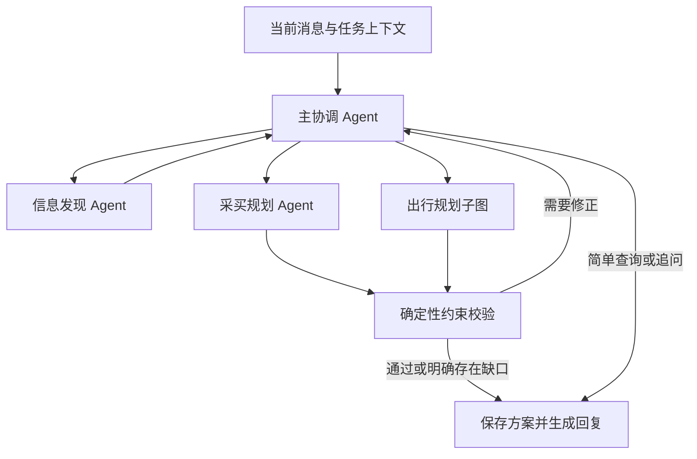

这是允许的协作关系，不要求每次请求遍历全部节点。附近店铺查询可能只使用信息发现；奖品采买通常需要发现、规划和金额校验；旅游可能产生带依赖的美食与采买任务。补搜与修正可以循环，但受统一调用预算和截止时间约束。

### 5.3 工具按职责组织

| 使用者 | 默认可用能力 | 约束 |
| --- | --- | --- |
| 主协调 | 任务上下文、偏好读取、结构化委派、追问 | 委派参数必须绑定当前任务与用户 |
| 信息发现 | 地图、天气、网络、知识库、三类平台目录 | 按任务需要提供工具子集；保存来源 |
| 采买规划 | 候选读取、数量金额计算、方案检查、发起补搜请求 | 使用候选标识；金额由程序复算 |
| 出行子图 | 交通酒店候选、路程时间、日程与预算检查、委派相关查询 | 独立日期、位置与费用范围 |
| 业务应用层 | 保存候选、方案、事件和状态 | 在指定入口执行权限、版本和归属检查 |

工具注册表至少包括名称、用途、输入输出 schema、允许角色、任务类型、超时、重试规则、来源类型和是否可能写入。平台查询工具的 `readOnlyHint` 等声明可辅助描述，实际访问能力由受信注册表与服务端权限控制。[3]

建议先设置每个任务执行最多 12 次外部工具调用、最多 2 轮规划修正、总执行期限 120 秒，作为可配置实验起点。主从 Agent 共享同一份调用预算；实际数值根据评估用例调整。超出预算时提供已有结果和缺口，或请求用户调整条件。

## 6. 主业务流程图

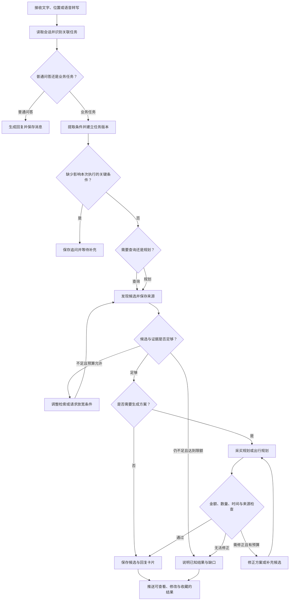

关键规则：

1. 追问按场景选择。给学生买奖品通常需要人数；附近推荐需要查询中心。预算缺失时可展示价格档位，不一律阻塞。
2. 用户修改条件后生成新任务版本，重新计算受影响部分。预算或数量变化不必重复抓取仍然有效的所有资料；地点和日期变化通常需要重查相关候选。
3. 扩大价格范围、距离或其他硬条件时向用户说明。保留用户条件，不能静默把超预算方案标为满足。
4. 候选、价格、营业时段和公司信息可以缺失。程序保留 `null` 或未知标记，展示缺口。
5. 日常采买、经营采购和旅游子任务分别保存条件。跨任务引用需要显式关联，不把一次性预算写入长期偏好。

### 6.1 出行规划子图

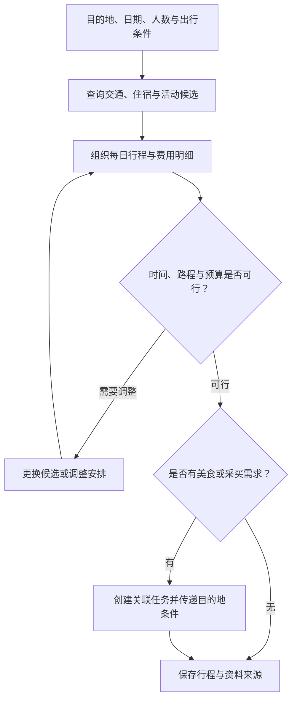

日期或出行人数修改后，交通、住宿和日程重新检查。关联美食任务的查询中心来自目的地，用户当前位置仍独立保留。交通酒店目录中的模拟价格在卡片中明确标注。

## 7. 任务模型、状态机与恢复

### 7.1 先区分五个对象

| 对象 | 含义 | 示例 |
| --- | --- | --- |
| `conversation` | 对话容器 | 一次生活助手会话 |
| `task` | 可独立保存条件与结果的业务目标 | 买奖品；规划杭州三日游 |
| `task_revision` | 某个任务的条件快照版本 | 奖品任务由 20 人改为 25 人 |
| `run` | 对某个任务版本的一次执行 | 第一次搜索规划；失败后手动重试 |
| `job` | 后台调度单元 | 消息路由、执行某个 run、同步投稿索引 |

一个会话包含多个任务。复合需求可以建立 `parent_task_id` 与任务依赖，例如先确定出行日期，再搜索交通。业务任务运行使用独立 LangGraph `thread_id`，建议初始直接采用 `run_id`；同一 run 在进程恢复时复用该 ID，不同任务或新执行使用不同 ID。[2]

### 7.2 执行状态机

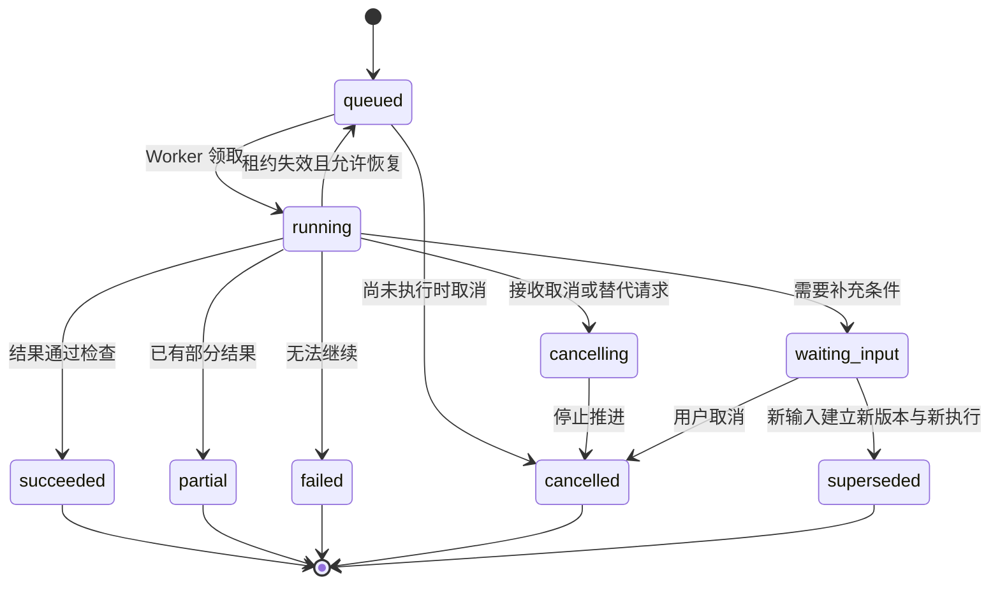

`waiting_input` 表示当前执行暂停推进，界面等待用户。初始实现建议采用以下统一策略：补充条件形成新的任务版本和新 run，旧的等待执行转为 `superseded`，新执行读取已确认条件和仍有效的候选。进程故障恢复则继续同一个 run 和检查点。这个策略使条件变更与故障恢复有明确区别。

取消发生在外部调用期间时，调用方尽力取消请求；即使上游仍返回，提交结果前仍检查状态和执行权。旧任务的迟到结果可以保留在审计记录中，不发布为当前任务结果。

### 7.3 正式数据与检查点分别保存

| 内容 | 保存位置 | 用途 |
| --- | --- | --- |
| 消息、条件版本、候选、方案、任务状态 | 主系统业务表 | 页面读取、查询与正式业务判断 |
| 图节点状态与恢复位置 | 持久化 LangGraph checkpointer | 同一执行中的恢复 |
| 工具输入摘要、结果或结果引用 | `tool_calls` 与证据记录 | 排错、恢复与来源追踪 |
| 待执行工作、执行者、租约、尝试次数 | `jobs` 与 `runs` | 跨进程调度与恢复 |
| 前端可见事件 | `conversation_events` | SSE 重连与事件补发 |
| 稳定用户偏好 | `user_preferences` | 跨任务使用，用户可修改删除 |

内存 checkpointer 只适合短时调试；需要跨进程重启恢复时使用持久化实现。[1] Checkpointer 本身不承担任务领取、执行所有权、业务权限和事件补发。

### 7.4 最低恢复与并发规则

- 消息接收时在一个事务内保存消息和路由 job。Worker 完成消息路由后，原子保存任务、版本、run 与相应执行 job。保存路由结果并设置唯一键，恢复时避免重复创建任务。
- Worker 原子领取工作，写入执行者、租约期限和递增的执行令牌。提交状态、事件和结果时检查令牌及当前任务版本，失去执行权的 Worker 停止写入。
- 初始按任务串行推进；条件更新、取消和新执行创建由应用层协调，旧 run 不覆盖新版本结果。
- 图检查点与业务写入未必位于同一个事务。方案、候选和工具结果等保存使用稳定操作键与唯一约束，允许恢复重放。
- 工具调用可能因故障再次执行；查询重新调用后再次核对资料时效。恢复不承诺外部调用恰好执行一次。
- 过期租约可触发有限恢复，超过截止时间或恢复次数则标记失败，向用户提供已保存结果。
- 刷新或关闭网页只影响订阅连接。取消操作必须显式调用取消接口。

## 8. 消息提交、后台执行与 SSE 时序图

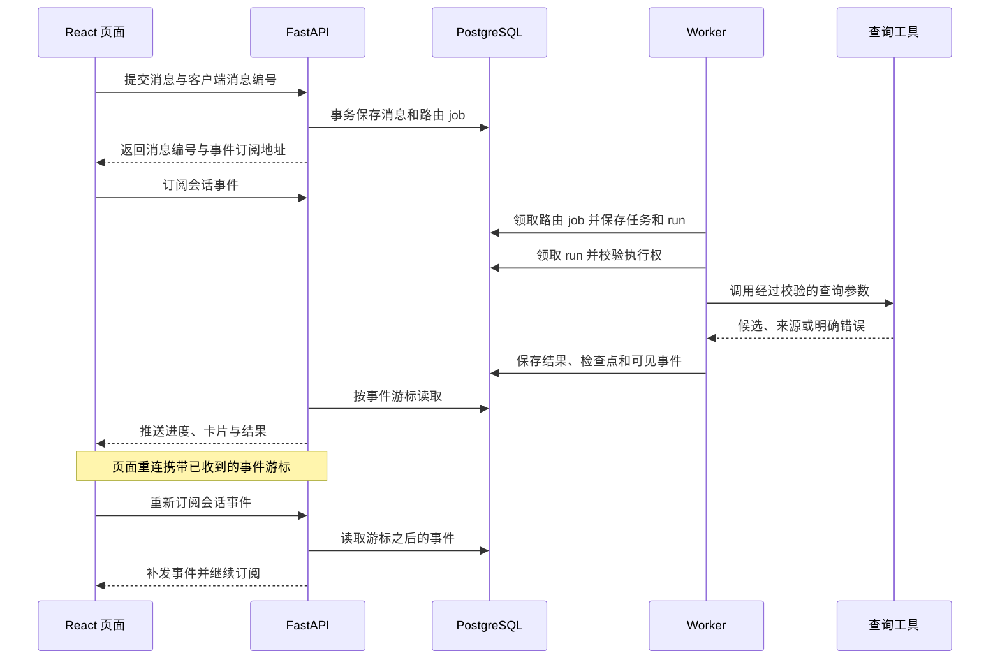

### 8.1 事件约定

建议采用 `task.created`、`run.status`、`message.delta`、`tool.started`、`tool.finished`、`candidate.upserted`、`clarification.requested`、`plan.ready`、`message.completed`、`run.failed`。

事件先持久化，再通过 SSE 推送。事件 ID 为服务端生成的有序游标，作为字符串传输；订阅同时按会话和用户权限过滤。前端按事件 ID 去重。文本增量可以按小片段合并持久化；正式消息结束后提供完整文本。

```json
{
  "schema_version": "1.0",
  "event_id": "1042",
  "type": "plan.ready",
  "conversation_id": "conversation_demo",
  "task_id": "task_prizes",
  "task_revision": 2,
  "run_id": "run_demo_2",
  "created_at": "2026-11-02T10:00:00+08:00",
  "payload": {
    "plan_id": "plan_demo",
    "plan_version": 1,
    "card_type": "purchase_plan"
  }
}
```

浏览器可通过同源安全会话 Cookie 认证订阅，或使用支持 Authorization 请求头的流式客户端。认证凭据不放在 URL 参数中。重连可使用 `Last-Event-ID`，页面重新打开时也可传入已保存的 `after_event_id`。事件过期无法补全时，接口明确要求重新读取消息、任务与方案快照。

界面展示事实性进度，如“已找到 8 个候选”“正在检查预算”，以及必要的工具名称和结果摘要。模型内部推理过程不作为产品事件。

## 9. 投稿、审核与知识检索流程

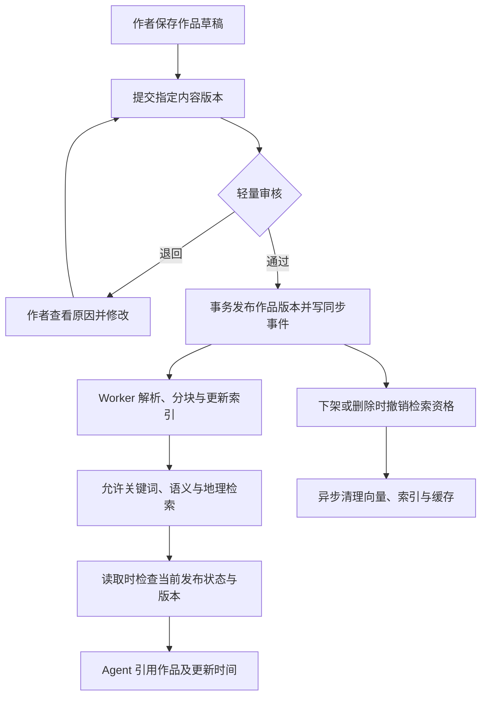

### 9.1 内容版本规则

- `posts` 保存作品身份、作者与当前有效发布版本；`post_versions` 保存不可变的正文、图片与结构化字段版本。
- 已发布作品修改时生成新草稿，审核通过后切换有效发布版本。页面显示当前发布内容及其更新时间。
- 发布、切换版本、下架等操作与索引同步事件同事务写入。同步事件携带作品 ID、版本号和动作，防止旧事件把失效内容重新索引。
- 下架立即改变数据库中的检索资格。检索命中后以及生成回复前检查发布状态和版本，异步索引清理期间仍能排除失效内容。
- 历史方案保留当时引用快照，但重新查看时提示来源已下架或更新；新推荐不使用已经失效的内容。
- 用户投稿属于用户分享；参考价格和营业体验带时间属性，展示来源身份与发布时间。

### 9.2 检索实现顺序

1. 首先实现发布资格过滤、结构化类别、位置距离和可解释的关键词匹配。
2. 加入 embedding 与 pgvector 语义召回，并保存 embedding 模型、维度、分块版本。
3. 关键词与向量分别召回，融合去重，再按距离、时效、条件和相关性排序。
4. 使用固定中文用例检查店名、小吃名称、别称、短查询和地理范围；再决定是否增加重排模型。

中文关键词召回初期可用规范化字段与受限子串匹配。数据量增长后根据测试选择索引和中文分词方案；不要直接把默认英文全文检索配置视为中文检索方案。语义分数不作为信息真实性证明。

图片作为投稿附件保存。若后续加入 OCR、图片描述或多模态检索，新增对应解析版本和来源字段。

## 10. 数据模型与 ER 图

以下是逻辑模型，字段列表只列初始核心项；建表前仍需补齐类型、约束、索引和删除策略。

### 10.1 会话、任务、执行与方案

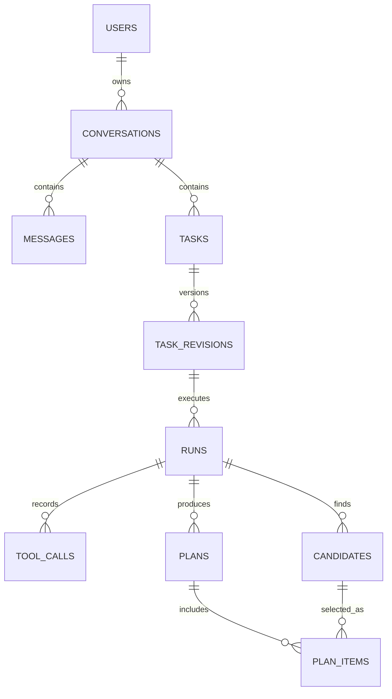

### 10.2 投稿与索引

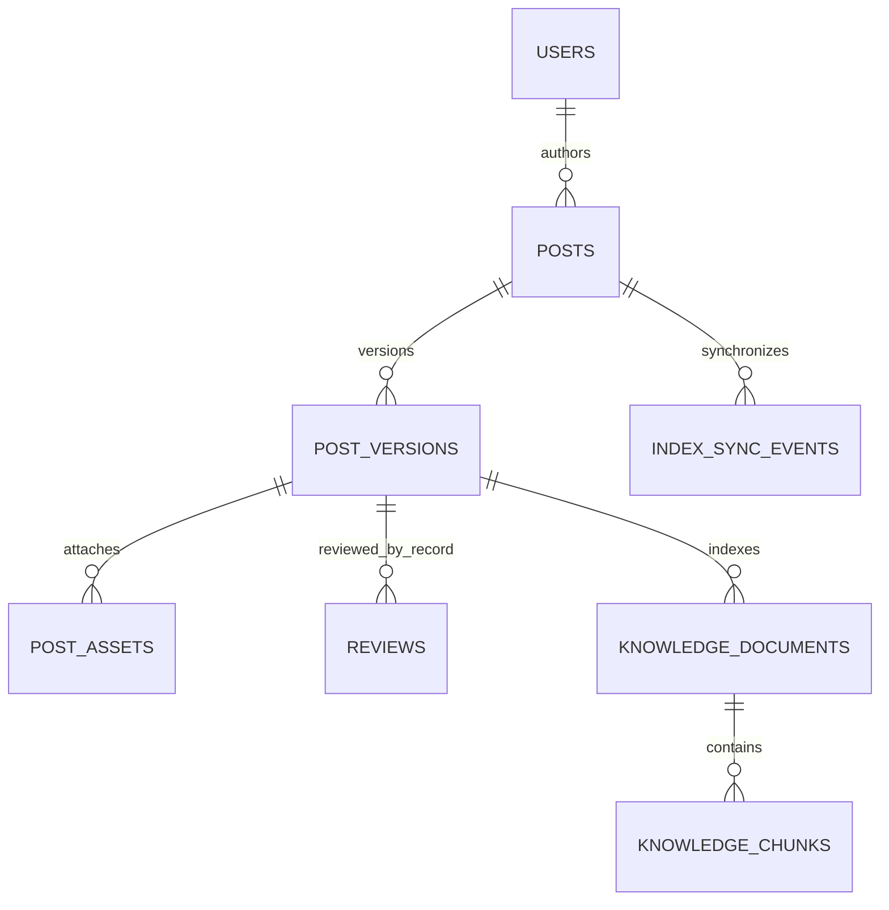

ER 图拆开呈现；工具来源、证据、收藏和 Java 目录等关联在下表补充。

### 10.3 Python 主系统核心数据字典

| 逻辑表 | 核心字段 | 主要规则 |
| --- | --- | --- |
| `users`、`user_roles` | 用户身份、登录标识、密码摘要或认证主体、角色、状态 | 密码使用适合密码的哈希；账号禁用即时校验 |
| `user_preferences` | 用户、偏好类型、值、用户确认来源、更新时间 | 稳定偏好可查看修改删除；一次性任务条件单独保存 |
| `saved_locations` | 用户、名称、经纬度、坐标系 | 保存位置与本次定位分别管理 |
| `conversations` | 用户、标题、创建与更新时间 | 所有查询校验归属 |
| `messages` | 会话、角色、内容、`client_message_id`、关联任务、状态 | 客户端消息编号用于提交幂等 |
| `tasks` | 会话、类型、`parent_task_id`、当前版本、业务状态 | 同一任务的正式结果绑定当前版本 |
| `task_dependencies` | 前置任务、后续任务、依赖条件 | 校验无循环，取消或失败时明确传播规则 |
| `task_revisions` | 任务、版本号、条件快照、触发消息 | `UNIQUE(task_id, revision)`；快照不可原地覆盖 |
| `runs` | 任务版本、状态、`graph_thread_id`、截止时间、检查点关联、错误 | 同一任务最多一个持有有效执行权的 run |
| `jobs` | 类型、资源标识、状态、执行者、租约、令牌、尝试次数、可执行时间 | 原子领取；业务操作键防止重复调度 |
| `tool_calls` | run、调用序号、工具、参数摘要、结果或引用、耗时、错误 | 过滤密钥与个人敏感字段；保留工具调用 ID |
| `evidence_sources` | 来源类型、平台标识、URL 或内部资源 ID、时间、快照摘要 | 真实公开、用户投稿和模拟目录有明确类型 |
| `candidates` | run、类别、来源实体 ID、规范化属性、价格依据、位置、快照版本 | 允许未知字段；模拟数据带标记 |
| `candidate_evidence` | 候选、证据、支持的字段或结论 | 区分支持价格、位置、营业时段等不同事实 |
| `plans` | task、任务版本、run、方案版本、类型、总额、检查结果、结构化内容 | 保存使用稳定操作键；历史版本可追溯 |
| `plan_items` | 方案、候选、平台资源 ID、规格、数量、单价、费用范围、证据 | 数量单位明确；来源快照保留 |
| `itinerary_days`、`itinerary_items` | 方案、日期、起止时间、地点、交通段、费用、来源 | 出行阶段建表；不把日程事实藏在聊天文本里 |
| `conversation_events` | 会话、事件 ID、task、run、类型、载荷、时间 | 按会话和游标查询；设置保留策略 |
| `posts`、`post_versions` | 作者、发布版本指针、版本正文、状态、位置、更新时间 | 撤销发布资格可即时过滤旧索引 |
| `post_assets`、`reviews` | 附件元数据、审核人、结论、原因、版本 | 审核绑定具体内容版本 |
| `knowledge_documents`、`knowledge_chunks` | 作品版本、分块内容、向量、模型与索引版本 | 检索返回前校验源内容当前资格 |
| `index_sync_events` | 作品、内容版本、动作、状态、次数、错误 | 与发布变更同事务写入，允许幂等重试 |
| `favorites` | 用户、目标类型、目标 ID、时间 | 目标归属与可见性检查，唯一键防重复 |
| `audit_logs` | 操作者、动作、资源、结果、时间、请求标识 | 记录审核、权限及配置等关键动作 |

### 10.4 Java 目录模型

| 服务 | 目录实体建议 | 关键字段 |
| --- | --- | --- |
| 购物采买 | 店铺、商品、SKU、卖家、二手商品 | 平台与目录 ID、标题、类别、规格、价格、单位、位置、成色、可售状态、更新时间 |
| 出行信息 | 酒店、房型或报价、模拟交通选项 | 目的地、日期适用范围、价格、人数条件、位置、说明、更新时间 |
| 本地生活 | 门店、菜单、规格、口味与价格项 | 门店位置、菜单名称、规格、价格、可选口味、营业信息、更新时间 |

三个目录都保留 `is_simulated=true`。模拟酒店信息不等于实时可订房，模拟二手可售状态不等于真实交易平台库存。

### 10.5 初始化时就要确定的数据规则

- 预算和确定金额使用整数分，或明确精度的 Decimal；涉及计算时统一币种和单位。约数、区间价和未知费用另存，不直接当作精确单价求和。
- 位置至少区分 `current_location`、`search_center`、`destination`、`purchase_location`；记录坐标系。使用高德数据时在适配边界处理坐标系，避免混用。
- 时间保存可比较的带时区时间，任务保留用户时区。旅游日期按目的地及用户约定解释，不能仅依赖服务器时区。
- 候选去重优先使用来源平台及实体 ID。跨来源同名实体可建立匹配关系，但证据和价格分别保留，不因同名合并库存或报价。
- 关键唯一键包括客户端消息 ID、任务版本、路由结果任务键、方案保存操作键、索引事件版本键。
- 所有来自外部或模型的数据进入正式方案前进行 schema 校验，当前用户身份由服务端注入。

## 11. REST 接口初稿

统一前缀建议 `/api/v1`；以下路径用于启动设计，HTTP 错误结构、分页及鉴权需要写入 OpenAPI。前端类型从已确认的协议生成或维护一致定义。

| 领域 | 接口建议 | 要点 |
| --- | --- | --- |
| 账号 | `POST /auth/register`、`POST /auth/login`、`POST /auth/logout`、`GET /me` | 注册是否开放按部署配置；服务端管理会话 |
| 会话 | `POST /conversations`、`GET /conversations`、`GET /conversations/{id}` | 校验用户归属，统一分页 |
| 消息 | `POST /conversations/{id}/messages`、`GET /conversations/{id}/messages` | 提交写消息与调度工作，携带幂等编号及可选目标任务 |
| 事件 | `GET /conversations/{id}/events` | SSE，支持游标、重连和事件权限检查 |
| 任务 | `GET /tasks/{id}`、`GET /tasks/{id}/revisions`、`POST /tasks/{id}/revisions` | 修改携带预期版本，冲突时明确返回 |
| 执行 | `GET /runs/{id}`、`POST /runs/{id}/cancel`、`POST /tasks/{id}/retry` | 复用后台任务执行入口 |
| 方案行程 | `GET /plans`、`GET /plans/{id}`、`POST /plans/{id}/save` | 方案查看与个人保存；修改条件转交任务版本接口 |
| 附近发现 | `GET /discover/nearby` | 显式查询中心和类别；调用与 Agent 共用的查询适配器 |
| 小吃街 | `GET /posts`、`GET /posts/{id}` | 公开查询只返回有效发布版本 |
| 投稿 | `POST /posts`、`PATCH /posts/{id}/draft`、`POST /posts/{id}/submit` | 编辑自己的草稿；提交绑定版本 |
| 审核 | `GET /admin/reviews`、`POST /admin/posts/{id}/reviews`、`POST /admin/posts/{id}/unpublish` | 审核权限与并发版本检查 |
| 图片 | `POST /uploads` | 类型、大小与归属校验；返回附件标识 |
| 收藏偏好 | `GET /favorites`、`POST /favorites`、`DELETE /favorites/{id}`、`GET /preferences`、`PATCH /preferences`、`DELETE /preferences/{id}` | 用户可控制个人记录和稳定偏好 |
| 模拟目录管理 | `/admin/catalogs/{platform}/...` | Python 门面转交受控 Java 管理接口，细化时补充资源路径 |
| 工具与索引 | `GET /admin/tools`、`GET /admin/index-jobs`、`POST /admin/index-jobs/{id}/retry` | 工具配置变更需验证受信地址与允许能力 |
| 运维 | `GET /health/live`、`GET /health/ready` | 存活与关键依赖就绪区分 |

消息提交、条件修改和手动重试统一进入应用层任务服务，再由 Worker 执行图。SSE 路由只订阅事件；后台运行逻辑保持一份。

通用错误建议包含 `code`、`message`、`request_id`、`retryable` 与必要的 `details`。页面根据结构化错误处理权限、版本冲突、无结果和依赖失败。

## 12. MCP 工具清单与候选协议

### 12.1 初始工具目录

| 来源 | 工具建议名 | 主要输入 | 输出 |
| --- | --- | --- | --- |
| 购物采买 MCP | `commerce.search_products` | 关键词、渠道、类别、预算范围、位置、分页 | 商城或二手候选 |
| 购物采买 MCP | `commerce.get_product_detail` | 平台、商品 ID、可选 SKU ID | 规格、报价、成色、店铺和来源 |
| 购物采买 MCP | `commerce.search_shops` | 关键词、类别、位置、分页 | 模拟店铺候选 |
| 出行 MCP | `travel.search_transport`、`travel.get_transport_detail` | 出发地、目的地、日期、人数或候选 ID | 模拟交通候选和详情 |
| 出行 MCP | `travel.search_hotels`、`travel.get_hotel_detail` | 目的地、入住离店日期、人数、预算或候选 ID | 模拟酒店候选和详情 |
| 本地生活 MCP | `local.search_stores` | 品牌、食品类别、位置、预算、分页 | 门店候选 |
| 本地生活 MCP | `local.get_menu`、`local.get_item_detail` | 门店、菜单项、规格标识 | 菜单、口味、规格和报价 |
| 地图适配器 | `map.search_places`、`map.get_place_detail`、`map.get_route` | 关键词、位置、距离、起终点 | 地点和路线资料 |
| 联网适配器 | `web.search`、`web.read_page` | 关键词、受控 URL | 公开资料及来源元数据 |
| 天气适配器 | `weather.get_weather` | 地点、所需日期范围 | 查询时可获得的天气与时间范围 |
| 投稿知识库 | `knowledge.search_posts` | 关键词、语义查询、位置、类别 | 有效投稿片段与作品 ID |
| 确定性工具 | `plan.calculate_cost`、`plan.check_constraints` | 有效候选、数量、费用与任务条件 | 复算金额、缺口、违反条件列表 |

地图、搜索、天气可以由官方 MCP 或 HTTP API 适配；业务侧使用稳定接口。可选参数保持可选，未知预算或位置不强行补造。搜索结果统一带分页或游标以及是否还有结果，避免把少量返回误称为完整列表。

工具参数和结果按 schema 校验；MCP 可以在 `structuredContent` 返回业务 JSON，并通过 `outputSchema` 描述结构。下方是本项目自定义的业务数据示例，不是另行定义 MCP 协议。[3]

### 12.2 统一候选示例

以下内容全部为设计演示数据。

```json
{
  "schema_version": "1.0",
  "request_id": "query_demo",
  "status": "ok",
  "candidates": [
    {
      "candidate_id": "candidate_notebook_demo",
      "entity_type": "product",
      "title": "示例学生笔记本",
      "source_type": "simulation_catalog",
      "source_platform": "demo_mall",
      "source_entity_id": "product_demo_1",
      "sku_id": "sku_demo_a5",
      "shop_id": "shop_demo_1",
      "specification": "A5，单本",
      "price": {
        "amount_cents": 800,
        "currency": "CNY",
        "unit": "本",
        "basis": "simulated_quote"
      },
      "availability": "simulated_available",
      "location": null,
      "detail_url": null,
      "observed_at": "2026-11-02T10:00:00+08:00",
      "is_simulated": true,
      "evidence_ids": ["evidence_demo_1"]
    }
  ],
  "page": {"cursor": null, "has_more": false},
  "warnings": [],
  "error": null
}
```

`source_entity_id`、`sku_id`、位置、价格和详情链接允许缺失。公开文章提到的商品不能凭标题补出平台 ID；地图附近商店也不能凭商品类别补出真实库存。

无匹配结果使用 `status=ok` 和空列表；上游超时或调用错误使用明确错误类型，区分可重试与不可重试。MCP 工具执行错误与协议错误按协议语义分别处理。[3]

### 12.3 工具调用最低规则

- Python 侧只连接管理员配置并校验过的受信 MCP 地址；当前允许清单只包含查询工具。
- 输入类型、位置范围、分页上限与返回大小在服务端校验；外部网页正文和投稿内容作为数据处理。
- 模型不接触服务密钥，不决定调用者身份，也不能通过工具描述扩展权限。
- 根据任务字段发送必要参数；错误日志隐藏密钥和不必要的个人信息。
- 读取网页经过 URL 校验，限制可访问协议和地址，阻止访问服务端私网资源；工具超时、有限重试与限流在适配层处理。
- 平台服务即使内部已存在交易接口，也不通过本期 MCP 注册暴露。

## 13. 结构化方案与卡片协议

### 13.1 方案示例

演示条件为 25 人、总预算 300 元。下方 250 元仅代表已知商品金额，配送、交通等未计费用单独说明。

```json
{
  "schema_version": "1.0",
  "plan_id": "plan_demo",
  "plan_version": 1,
  "task_id": "task_prizes",
  "task_revision": 2,
  "type": "purchase_plan",
  "title": "25 人奖品采买方案",
  "conditions": {"purpose": "学生奖品", "people_count": 25, "budget_cents": 30000},
  "items": [
    {
      "candidate_id": "candidate_notebook_demo",
      "source_platform": "demo_mall",
      "source_entity_id": "product_demo_1",
      "sku_id": "sku_demo_a5",
      "specification": "A5，单本",
      "quantity": 25,
      "unit": "本",
      "unit_price_cents": 800,
      "subtotal_cents": 20000,
      "evidence_ids": ["evidence_demo_1"]
    },
    {
      "candidate_id": "candidate_pen_demo",
      "source_platform": "demo_mall",
      "source_entity_id": "product_demo_2",
      "sku_id": "sku_demo_black",
      "specification": "黑色，单支",
      "quantity": 25,
      "unit": "支",
      "unit_price_cents": 200,
      "subtotal_cents": 5000,
      "evidence_ids": ["evidence_demo_2"]
    }
  ],
  "cost": {
    "currency": "CNY",
    "known_goods_total_cents": 25000,
    "remaining_after_known_goods_cents": 5000,
    "unpriced_components": ["可能的配送费", "到店交通费用"],
    "budget_status": "known_goods_within_budget"
  },
  "checks": {"people_covered": true, "quantities_valid": true, "known_goods_cost_valid": true},
  "is_estimate": true,
  "is_simulated": true,
  "execution_status": "not_enabled"
}
```

方案应保留候选快照与证据关联，页面可显示来源、模拟标记和金额范围。公开信息、用户分享、模拟报价分别标注。缺少必要标识的候选仍可作为购买建议。

### 13.2 卡片类型

| 卡片 | 核心内容 | 当前操作 |
| --- | --- | --- |
| `clarification` | 问题、选项、可选字段、任务 ID | 补充条件 |
| `place` | 商店或摊位、位置、距离依据、来源 | 看地图、看详情、收藏 |
| `product` | 商品、规格、参考价、平台与模拟标记 | 比较、查看详情、加入规划候选 |
| `comparison` | 候选维度、已知不足、引用 | 修改筛选条件、展开来源 |
| `purchase_plan` | 数量、单价、金额、预算范围、购买地点 | 改条件、保存方案、查看候选 |
| `itinerary` | 日期安排、交通住宿、预计费用、来源 | 改日期、改预算、保存行程 |
| `post` | 投稿摘要、作者、位置、发布时间 | 查看作品、收藏 |
| `notice` | 超时、未知信息、无匹配或部分完成 | 重试、调整条件 |

卡片统一带 `schema_version`、`card_id`、`type`、`task_id`、`task_revision`、`resource_id` 和允许的动作。前端根据结构化卡片渲染，服务端仍校验操作权限与版本。前端不通过解析回答文字计算总价或推断商品标识。

### 13.3 后续交易衔接

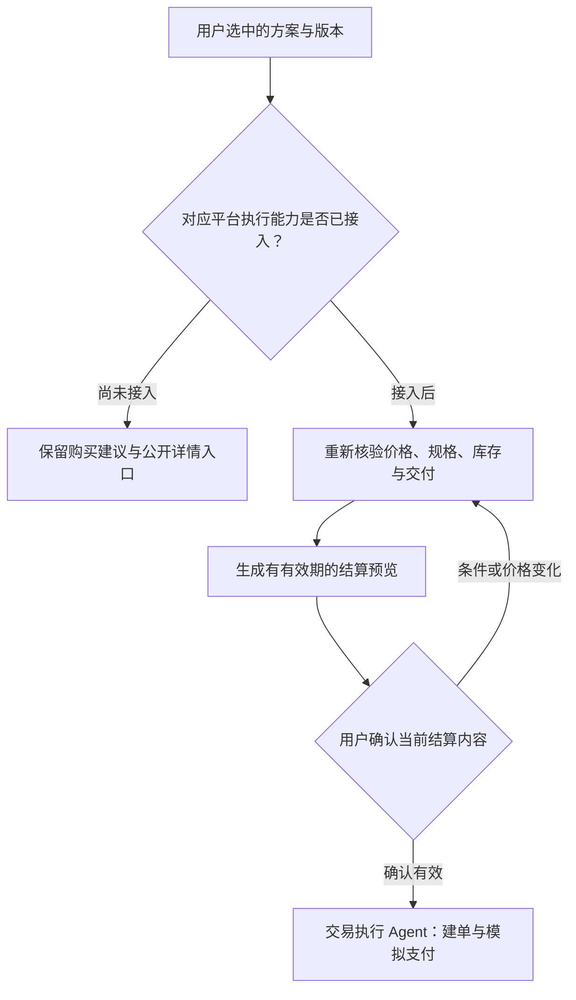

当前仅实现结构化方案和建议入口；本图属于扩展设计。未来通过方案 ID 和版本读取用户选择，再由交易服务复核。涉及确认、幂等、金额与状态的保护在执行服务落实，交易状态以服务端查回结果为准。

## 14. 页面结构与第一批原型

用户网页可以采用左侧会话和资料入口、中央对话、可展开的方案或地图区域。第一批用低保真原型确认信息与操作，再做视觉细化。

| 页面或区域 | 初始内容 | 首批优先级 |
| --- | --- | --- |
| 登录与个人入口 | 登录状态、账号、退出 | 高 |
| 智能助手 | 会话列表、输入、任务进度、追问、候选与方案卡片 | 最高 |
| 任务详情 | 当前条件、状态、方案版本、取消或重试 | 最高 |
| 方案与行程 | 已生成与个人保存记录、详情和来源 | 高 |
| 附近发现 | 手动选点、类别、距离、美食商店卡片、地图 | 第二阶段 |
| 小吃街 | 作品列表、位置筛选、详情、关联来源 | 第二阶段 |
| 投稿编辑 | 草稿、图片、位置、提交和审核结果 | 投稿阶段 |
| 个人中心 | 收藏、偏好、保存位置、投稿和历史任务 | 分阶段 |
| 管理页面 | 投稿审核、目录维护、索引任务、用户角色和工具状态 | 与对应业务同阶段 |

定位和麦克风按使用动作请求授权。拒绝后继续提供手动位置与文字输入。语音先转写到可编辑输入框，再由用户提交；具体语音服务在兼容性与成本验证后选定。

## 15. 仓库与代码目录建议

建议暂用仓库名 `life-buying-agent`；这只是代码仓库建议名，中文项目名称沿用计划书。

### 15.1 顶层目录

| 路径 | 内容 |
| --- | --- |
| `apps/web/` | React 用户端与 `/admin` 管理路由 |
| `apps/backend/` | Python 主后端、Agent 与 Worker |
| `services/java-mcp/commerce/` | 购物采买 Java 子项目 |
| `services/java-mcp/travel/` | 出行 Java 子项目 |
| `services/java-mcp/local-life/` | 本地生活 Java 子项目 |
| `services/java-mcp/common/` | 确有复用时提取的协议、错误和基础组件 |
| `contracts/` | 卡片、事件、候选、方案和 MCP 业务 schema |
| `docs/` | 架构、数据设计、接口、开发记录与部署说明 |
| `infra/` | Compose、代理、数据库初始化及环境示例 |
| `fixtures/` | 明确标注模拟的目录、投稿与任务样例 |
| `evals/` | 场景用例、约束答案与评估记录 |
| `apps/android/` | 后续开展 Android 开发时创建 |

不必在第一天创建没有实际行为的全部模块。目录结构按功能逐步落地。

### 15.2 Python 内部

| 路径，相对 `apps/backend/` | 职责 |
| --- | --- |
| `src/life_agent/main.py` | API 启动入口 |
| `src/life_agent/worker.py` | Worker 启动入口 |
| `src/life_agent/api/` | 路由、鉴权依赖、请求响应转换 |
| `src/life_agent/modules/identity/` | 账号与角色 |
| `src/life_agent/modules/conversations/` | 会话与消息 |
| `src/life_agent/modules/tasks/` | 条件版本、run、调度协调与取消 |
| `src/life_agent/modules/plans/` | 方案保存、金额规则、记录查询 |
| `src/life_agent/modules/posts/` | 投稿、审核、发布版本 |
| `src/life_agent/modules/knowledge/` | 索引同步、检索资格与召回 |
| `src/life_agent/modules/profile/` | 偏好、收藏与保存位置 |
| `src/life_agent/agents/coordinator/` | 主协调图、提示词、结构化路由 |
| `src/life_agent/agents/discovery/` | 信息发现与补搜 |
| `src/life_agent/agents/purchase/` | 采买规划与修正 |
| `src/life_agent/agents/travel/` | 出行规划子图 |
| `src/life_agent/agents/shared/` | 最小共享状态、上下文组装、统一预算 |
| `src/life_agent/tools/discovery/` | 按发现职责封装的工具入口 |
| `src/life_agent/tools/planning/` | 预算、数量、时间和约束工具 |
| `src/life_agent/tools/runtime/` | 受信注册表、权限、schema 校验和调用日志 |
| `src/life_agent/integrations/` | MCP 客户端、LLM、地图、搜索、天气和存储适配 |
| `src/life_agent/infrastructure/` | 数据库会话、队列、事件、checkpointer 和基础观测 |
| `migrations/` | 主系统数据库迁移 |
| `tests/` | 业务与协议验证、必要的集成回归 |

每个业务模块可从 `models.py`、`schemas.py`、`service.py`、`repository.py` 开始；确有复杂度再细分。Agent 负责推理和委派，正式写入规则由业务服务执行。

### 15.3 React 内部

建议按 `features/chat`、`features/tasks`、`features/plans`、`features/discover`、`features/posts`、`features/profile`、`features/admin` 分模块。公共部分包括 `components/cards`、`api`、`events`、`types` 与路由。

服务端协议先确认，再实现卡片组件。SSE、消息状态和任务状态统一维护，避免各页面各自创建一套执行过程。

### 15.4 Java 初始化前核对

对现有 Java 项目先记录 JDK、Spring Boot、构建工具、实体、鉴权和数据库迁移情况。再确定 MCP SDK 与传输方式，优先复用已有查询业务。跨容器可采用所选 SDK 支持的 HTTP MCP 传输，具体实现通过 Python 客户端握手、工具发现、调用和错误测试确认。

三个服务可使用共同父工程与公共基础组件，保持独立配置、工具注册和数据归属。不要求照搬 GoGo 的目录数量。

## 16. 环境、依赖与外部资源清单

| 类别 | 启动前准备 | 验证方式 |
| --- | --- | --- |
| Python 环境 | 项目解释器、依赖管理、FastAPI、LangGraph、数据库与迁移依赖 | 安装、锁文件、导入和最小服务启动 |
| 前端环境 | Node、包管理器、React、TypeScript、构建工具 | 锁文件、类型检查和构建 |
| Java 环境 | 与现有项目相容的 JDK、构建工具、Spring Boot 与 MCP SDK | 构建、启动和工具调用 |
| PostgreSQL | 主库账号、服务角色、持久卷、备份位置 | 迁移、权限和重启后数据仍在 |
| LLM | 模型端点、凭据、模型名、超时配置 | 一次真实工具调用和结构化结果校验 |
| Embedding | 模型端点或本地实现、模型名、实际向量维度 | 中文文本请求、维度与相似检索检查 |
| 搜索 | Tavily 或其他选定服务；MCP 或 API 适配 | 查询、来源字段、无结果和额度错误 |
| 地图 | 高德服务配置、网页地图要求、密钥使用限制 | 手动位置、地点详情和路线查询 |
| 天气 | 选定服务或地图提供的天气能力 | 明确地点、日期范围、观测或预报时间 |
| 图片存储 | 存储目录或对象存储、访问权限和大小限制 | 上传、读取、归属与备份验证 |
| 语音 | 浏览器能力或服务端语音转写适配 | 拒绝权限、转写编辑和失败回退 |
| 容器环境 | Docker Compose、服务网络、代理与卷 | 一条命令启动、健康检查和停止重启 |

环境变量名称建议：`DATABASE_URL`、`LLM_BASE_URL`、`LLM_API_KEY`、`LLM_MODEL`、`EMBEDDING_MODEL`、`EMBEDDING_DIM`、`COMMERCE_MCP_URL`、`TRAVEL_MCP_URL`、`LOCAL_LIFE_MCP_URL`、`MAP_PROVIDER`、`WEB_SEARCH_PROVIDER`、`STORAGE_BACKEND`。这些是命名建议，不预设具体 SDK 的配置方式。

`.env.example` 仅保留示例与说明，真实凭据通过环境或部署配置注入。模拟与真实服务必须使用显式配置区分，测试报告记录实际调用模式。

### 16.1 首先完成的兼容性小验证

1. LLM 能完成一次真实的结构化工具调用，而非只验证普通文本回复。
2. Python MCP 客户端能完成一个 Java 服务的连接、工具发现、调用、结果校验和错误处理。
3. PostgreSQL 迁移和持久化 checkpointer 能工作，Worker 进程重启后恢复同一执行。
4. React 经代理订阅 SSE，刷新后能按游标补事件。
5. 投稿检索阶段开始前验证 embedding 的实际维度、中文效果和依赖兼容性。

## 17. 演示数据与评估用例

### 17.1 演示数据建议

准备一个可复现的小型数据集：2 个演示查询中心、约 6 家模拟店铺、20—30 个商品或 SKU、若干二手商品、饮品门店及菜单、酒店交通候选、10—15 篇投稿。数量是初始建议，重点是覆盖条件和异常分支。

数据中故意保留少量缺价、已下架、重复名称、无坐标、无合适规格和无匹配结果，验证系统如何表达未知与失败。所有模拟项在数据库、工具结果和页面中可辨认。

### 17.2 用例与验收

| 用例 | 预期行为 | 自动或人工可核对的结果 |
| --- | --- | --- |
| 教师奖品，预算 300 元，人数未知 | 追问人数，搜索商品，组合与计算 | 人数覆盖、数量和已知金额正确，来源齐全 |
| 人数从 20 改成 25 | 创建新条件版本，重算数量费用 | 新版本结果准确，旧 run 不覆盖 |
| 天冷买通勤衣服，没有预算 | 查天气，给类别和价格档位 | 不强迫先给预算；不编造尺码库存 |
| 附近便宜夜宵 | 依据查询中心联查地图、投稿和网络 | 去重、距离和来源类型可查 |
| 投稿发布、修改和下架 | 发布后可检索，切换版本，下架失效 | 旧索引和缓存不继续提供新推荐 |
| 杭州三日游，调整日期 | 更新交通、酒店、日程及关联任务 | 时间可行，目的地与当前位置分开 |
| 店铺设备批量采购 | 查公开公司产品，比较规格与不足 | 未知资质与价格明确标记，不自动联系 |
| 想喝蜜雪，给我点一杯 | 解释当前查询推荐能力，补充规格需求 | 返回门店饮品候选，不出现交易成功 |
| 附近二手商品筛选 | 查询成色、位置、价格与可售状态 | 模拟标记与筛选条件正确 |
| 没有符合全部硬条件的候选 | 补搜，或说明缺口并建议调整 | 不静默放宽预算或位置 |
| 刷新网页、Worker 重启 | 补事件，恢复执行或明确失败 | 无重复方案、无跨用户记录混入 |
| 取消时工具迟到返回 | 检查取消、版本和执行权 | 结果不发布为当前方案 |
| 提交相同消息、重复同步事件 | 依赖唯一键和幂等逻辑 | 不重复创建业务任务或有效索引 |
| 投稿正文包含诱导工具指令 | 作为来源文本处理 | 无越权工具调用 |

评估记录任务完成率、约束满足率、工具调用有效率、来源支持率、追问必要性、条件修改正确性、恢复成功情况，以及耗时和调用次数。初期记录基线，暂不填写未经实测的达标百分比。

引用核对不仅看有没有 URL，还看价格、位置、营业时间或结论是否由对应来源支持。对“基础问答、检索问答、带工具和确定性校验的 Agent”使用同一组任务比较。

## 18. 全范围实施顺序

这是开发顺序，不删除计划书中的其他情景。

| 阶段 | 交付 | 进入下一阶段的依据 |
| --- | --- | --- |
| A：骨架与兼容性 | 仓库、锁文件、Compose、数据库迁移、账号基础、一个 MCP 查询、LLM 工具调用、SSE 样例 | 关键协议和依赖已跑通 |
| B：首条完整采买链路 | 教师奖品需求、人数追问、候选、金额复算、方案卡片、保存与恢复 | 可从输入完成到方案，能改人数和预算 |
| C：信息发现扩展 | 地图、天气、网络搜索、附近店铺、日用品与天气衣物 | 多来源有证据，位置和价格含义清楚 |
| D：本地生活与知识 | 小吃街投稿、审核、索引、附近夜宵、菜单与饮品卡片 | 内容更新失效有效，能按口味规格追问 |
| E：二手与经营采购 | 二手筛选、公司和设备比较、数量规格预算 | 同一规划骨架支持不同条件与结果类型 |
| F：旅游与出差 | 出行 MCP、规划子图、交通酒店日程、关联美食采买 | 日期预算修改后能重新检查 |
| G：完善与验收 | 语音、权限完整性、后台、故障恢复、评估、部署与论文材料 | 场景矩阵、部署和演示可复现 |
| H：可选扩展 | Android；交易执行、模拟订单和支付 | 前述业务协议稳定，并单独完成扩展验收 |

每一阶段按需要完善对应管理功能与回归用例，不把全部管理后台集中到最后才补。阶段长度由可投入时间、现有 Java 可复用程度和实际联调结果决定。

## 19. 首阶段可以直接交给 Codex 的任务

> 根据本设计包和当前《生活采买智能体_课题项目计划书》，先完成阶段 A，并为阶段 B 建立最小可运行骨架。保持 React 优先、Python 主系统、三个 Java 查询型 MCP 的边界。先检查仓库和现有 Java 项目，再制定具体改动；不存在的部分按设计初始化。
>
> 1. 核对现有代码、JDK、Python、Node、构建工具和数据库版本，记录兼容性选择并生成锁文件。
> 2. 建立 Web、Python API/Worker、Java 购物采买查询入口、PostgreSQL 与 Compose。其他 Java 服务保留实施设计，按对应阶段实现，勿用空接口假装完成。
> 3. 定义并验证消息、任务条件、候选、方案、卡片和 SSE 事件的第一版 schema。
> 4. 完成账号与资源归属基础、会话和消息保存、持久化 job/run、事件表与 SSE 订阅。
> 5. 验证 LLM 真实工具调用、Python 到 Java 的 MCP 查询以及 PostgreSQL checkpointer。外部配置不可用时报告阻塞与模拟模式，分别记录验证结果。
> 6. 按“25 人、300 元教师奖品”准备明确标注模拟的商品数据，打通发现、预算计算和方案卡片的最小演示。
> 7. 补充覆盖消息幂等、金额计算、资源归属、事件重连和恢复的必要验证，记录实际执行结果。
> 8. 更新启动说明、环境变量示例、架构说明和进度记录；汇报已完成、待完成、实际测试与已知限制。
>
> 所有消息和任务执行共用同一个后台运行入口。任务修改绑定版本，来源类型和模拟标记贯穿工具、方案与卡片。当前平台注册只包含查询能力。

## 20. 首阶段完成标准

- [ ] 新环境可按说明启动 Web、API、Worker、PostgreSQL 和购物采买 MCP。
- [ ] 未登录与跨用户访问受到实际服务端限制。
- [ ] 消息、后台工作与事件记录能够持久保存，重复提交不会重复创建同一任务。
- [ ] 页面能收到事实性进度和结构化方案卡片，刷新后能补发或恢复查看。
- [ ] 一次真实 LLM 工具调用和一次 Java MCP 查询均有验证结果；模拟模式与真实模式明确区分。
- [ ] 25 人奖品方案的数量、单价与总额由确定性代码复算，未知费用明确列出。
- [ ] 条件修改不会被旧执行覆盖；取消后的迟到结果不会发布。
- [ ] Worker 重启能恢复同一 run，或给出明确失败状态及已保存记录。
- [ ] 文档能说明代码模块、进程容器、数据所有权与后续各阶段交付。

## 参考资料与使用范围

本文的业务范围来自用户本次提供的计划书。架构、数据字段、目录、接口及实施顺序为针对该计划的设计建议。以下官方资料用于核对框架能力，不代表已经验证本项目所选版本。

1. [LangGraph Persistence](https://docs.langchain.com/oss/python/langgraph/persistence)：检查点、跨线程存储与持久化职责。
2. [LangGraph Checkpointers](https://docs.langchain.com/oss/python/langgraph/checkpointers)：线程标识、检查点及恢复相关机制。
3. [MCP Tools specification](https://modelcontextprotocol.io/specification/2025-11-25/server/tools)：工具发现调用、输入输出 schema、结构化结果、错误与访问控制要求。本设计引用该版本解释协议结构；SDK 与协议版本在项目初始化时核对并锁定。

