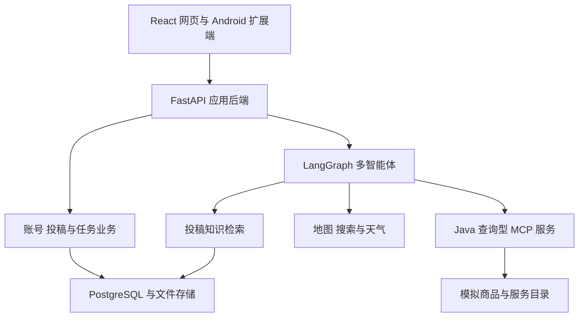

# 生活采买智能体课题项目计划大纲

> 2026-11-02 定位补充：Java 服务用于模拟外部 MCP 并验证通用接入，不预设存在可复用 Java 业务项目；后续支持其他 MCP 服务。最新产品口径见 [项目定位](project.md)，推进顺序见 [路线图](../roadmap.md)。下文保留原始范围规划，不代表已实现。

**课题名称：基于大语言模型与 MCP 的多场景生活服务智能体系统设计与实现**

## 一、项目概述

建设一个以采买为核心、面向 Web 网页与 Android App 双端的生活服务智能体，优先开发 React 网页版，Android App 根据后续实际情况开展。用户通过自然语言描述需求，系统结合用途、预算、位置、时间、数量和偏好，调用地图、联网搜索、投稿知识库及模拟业务平台，完成日常采买推荐、美食发现、旅游与出差规划、经营采购分析，并通过对话卡片展示候选、比较结果与可调整的方案。当前平台接入以搜索、详情查询和推荐规划为范围，不开放直接下单、预订或支付工具；原有模拟交易设想保留为扩展能力。

系统采用 Python＋FastAPI 构建主体后端，LangGraph 组织多智能体，改造现有 Java 项目建设 MCP 服务。网页版提供完整的用户功能与管理后台，包括对话入口、附近发现、小吃街栏目和个人记录。双端共享后端接口、账号体系、业务数据和卡片协议，便于后续接入 Android App。

## 二、项目目标

1. 理解用户的生活情景，围绕实际用途推荐商品、商家和服务。
2. 融合地图、网络资料与用户投稿，提供有出处的推荐结果。
3. 连接旅游、美食和采买需求，同时独立管理各任务的预算、位置与操作。
4. 支持文字、语音、位置输入及结构化卡片交互。
5. 通过自建 MCP 服务查询商城、二手、外卖及出行信息，形成有来源的候选和推荐方案。
6. 支持会话保存、任务恢复、偏好管理和基础业务防护。

## 三、用户角色

| 角色 | 主要功能 |
| --- | --- |
| 普通用户 | 对话查询、采买推荐、美食发现、出行规划、方案收藏和个人记录查询 |
| 内容投稿者 | 分享小吃街或摊位作品，编辑自己的内容，查看审核结果 |
| 内容审核员 | 发布、退回修改和下架投稿 |
| 模拟商家或卖家 | 管理模拟店铺、商品、菜单和可售信息 |
| 管理员 | 管理账号权限、内容、模拟数据、知识索引和工具配置 |

教师、消费者和私人经营者作为任务情景使用同一套用户体系，不分别建立账号系统。

## 四、主要功能

### 4.1 智能对话与任务管理

- 支持自然语言输入，识别用途、预算、人数、数量、位置、日期和偏好。
- 在缺少关键条件时追问；没有预算时提供价格档位，不强制填写固定表单。
- 支持多轮补充、条件修改、任务取消、历史查询和中断恢复。
- 流式展示任务进度、查询结果、推荐方案和操作卡片。
- 同一对话支持多个关联任务，各自保存条件和执行状态。

### 4.2 日常采买与附近店铺推荐

围绕教师奖品、生活用品、聚会采购等用途，给出商品组合及购买地点，优先考虑附近超市、商场和店铺。

例如：“给本次期末考试进步的学生买奖品，预算三百元。”系统补充人数等必要条件，提供商品、数量、参考单价、总价、推荐理由、店铺位置、距离及信息来源；用户调整人数和预算后重新计算方案。

商品价格区分网络参考价格与模拟平台报价，真实地图店铺不直接关联未经核实的库存。

### 4.3 天气相关购物

结合指定地点的天气、穿着用途和个人偏好，推荐衣物类别、搭配与购买店铺。支持有预算和无预算两种表达，可继续按价格、距离和风格调整。

例如：“最近天气冷了，想买适合通勤的衣服。”系统查询天气，结合用户需求推荐衣物与购买地点，不根据天气推断实际库存或个人尺码。

### 4.4 美食、酒店与附近发现

支持附近美食、目的地美食、小吃街、特色摊位及酒店查询。结合口味、类别、人均预算、距离和营业时段筛选候选。

融合高德地图、联网搜索和投稿知识库，去重后展示特色、位置、参考价格、时间及出处。提供地图选点、路线入口、相关作品、商品或菜单详情和收藏功能。

### 4.5 小吃街投稿与知识库

以图文作品形式收集用户分享，内容包括小吃街或摊位名称、位置、图片、特色食品、参考价格和体验说明，允许非必要字段留空。

- 投稿流程：编辑、提交、轻量审核、发布或退回修改。
- 审核重点为基础信息、明显垃圾内容和重复内容，不要求复杂商家资质。
- 栏目展示作品卡片、详情、作者、位置及更新时间。
- 正式发布内容进入知识索引，支持语义、关键词和地理条件检索。
- 内容修改、下架和删除同步影响检索资格，避免推荐失效内容。
- Agent 可主动发现相关作品，例如回答“附近便宜的夜宵”时引用摊位投稿，并标明用户分享来源。

### 4.6 旅游与出差规划

结合目的地、日期、出发地、人数、预算及必到地点，组织交通、住宿、活动和每日行程，并联动目的地美食及采买推荐。

参考 GoGo 的主从 Agent 分工、需求补全、候选保存、方案计算、客观检查和迭代修复策略。相关 Java 规划能力可通过服务接口适配，或将适用策略在 Python 主体中实现。

结果包括交通建议、酒店候选、每日安排、预计费用、位置关系和资料来源。用户调整日期、预算或偏好后重新检查行程。旅游模块聚焦规划，不包含企业差旅审批、报销和真实出票订房。

### 4.7 经营与批量采购

根据经营用途、产品或设备类型、数量、预算、规格和交付地区，检索公开公司及产品信息，形成合作候选对比。

展示公司业务、相关产品设备、适配理由、已知不足、公开联系方式及来源。未知信息明确说明，经营采购独立于个人消费任务，不自动联系商家、签约或付款。

### 4.8 模拟平台商品与服务查询

- 商城：搜索店铺、商品、规格、参考价格及可售信息，按用途、预算和地点筛选。
- 二手：查询单件商品、成色、卖家、位置及可售状态，提供闲鱼式商品发现与比较。
- 外卖：查询门店、菜单、规格、口味及参考价格，结合需求推荐。
- 对话采买：理解意图，按需追问，补充检索，比较候选，展示商品组合、预算估算和购买地点。

例如：“想喝蜜雪冰城，给我点一杯。”系统说明当前可查询和推荐，询问必要口味条件，展示匹配门店、饮品、规格及参考价格卡片，用户可以继续调整选择。

### 4.9 规划到下单的衔接与模拟支付扩展

保留商城、二手和外卖的选购、结算预览、用户确认、模拟建单、订单查询及纯模拟支付设想。当前不注册创建订单、扣减库存、预订、支付、取消订单或退款等交易工具，推荐卡片不显示系统内下单与支付按钮。

采买规划结果采用结构化方案保存，记录方案编号、候选来源、平台及店铺、可获得的商品或SKU标识、规格、数量、参考价格、预算明细和选择条件，并与展示卡片关联。后续交易执行读取用户选中的方案，不依赖从聊天文字重新猜测商品和数量。仅有公开资料、缺少交易平台标识的候选保留为购买建议，接入对应平台能力后再衔接下单。

规划与执行之间保留清晰接口：用户选择方案后，交易服务重新核验商品、规格、价格、库存及交付信息，生成结算预览；用户确认后才能创建订单，再进入支付和状态查询。确认绑定当前方案与结算内容，条件或价格变化时重新确认。原有查询与规划能力可继续复用，交易工具按平台实际支持情况接入。

交易能力接入时，可增加交易执行 Agent 和订单页面，通过自建收银台或假跳转演示纯模拟支付，并保留用户归属校验、服务端金额计算、重复请求防护、支付有效期、状态校验及结果回查等基本保护。二手议价、卖家聊天、配送、退款和售后属于相关扩展。

### 4.10 偏好与个人记录

保存用户明确表达的稳定偏好，如口味、购物距离和出行倾向，支持查看、修改和删除。一次性预算与当次数量归属具体任务。

个人记录包括历史会话、投稿、收藏、采买方案和行程；模拟订单记录随交易能力扩展接入。

## 五、终端与页面

| 终端 | 页面与职责 |
| --- | --- |
| 用户网页（优先开发） | 智能助手、附近发现、小吃街栏目、投稿编辑、方案与行程、收藏、个人中心及交互卡片 |
| Android App（视情况开展） | 复用后端与业务能力，提供对应的移动端页面，适配原生定位、语音和卡片交互 |
| 网页管理后台 | 投稿审核、店铺商品及菜单维护、用户权限、知识同步和工具管理 |

网页支持手动指定位置和文字输入；使用浏览器定位或语音输入时按需请求授权，拒绝后保留手动选点和文字输入。Android App 开展后，在用户主动使用附近功能时申请前台定位权限，使用语音输入时申请麦克风权限；不要求后台持续定位或常驻监听。

当前位置、搜索中心、旅游目的地和购买地点分别管理，目的地查询不覆盖用户当前位置；交易扩展可增加收货地点。

## 六、技术栈与总体架构

| 部分 | 技术方案 |
| --- | --- |
| 主体后端 | Python＋FastAPI |
| Agent 编排 | LangGraph |
| 网页（优先开发） | React＋TypeScript |
| Android（视情况开展） | Kotlin＋Jetpack Compose |
| 自建 MCP | 改造现有 Java 业务项目，当前通过 MCP 暴露搜索和详情查询工具 |
| 主数据库 | PostgreSQL，知识检索可扩展 pgvector |
| 外部能力 | 高德地图 MCP／API、联网搜索、天气和语音识别接口 |
| 通信 | REST 业务接口、SSE 对话事件、MCP 服务间调用 |
| 配套能力 | 文件图片存储、缓存与限流、持久化任务执行 |
| 部署 | Docker Compose 组织应用与基础服务 |

Python 管理主系统账号、会话、投稿、知识、任务与推荐方案；Java 模拟服务提供商品、门店、菜单、交通酒店等目录的查询能力。平台底层即使已有交易接口，也不向 Agent 暴露。投稿、审核、偏好和方案保存等主系统功能仍正常提供。

## 七、多智能体设计

围绕采买采用主协调、信息发现、方案规划的职责分工，参考 GoGo 的自主委派、工具调用、候选保存、约束检查和调整机制。

| Agent／能力 | 职责 |
| --- | --- |
| 主协调 Agent | 理解目标、追问关键条件、委派检索与规划任务、协调相关需求并汇总结果 |
| 信息发现 Agent | 联合地图、网络、投稿知识库和平台目录，查找商品、商家、美食、公司及公开资料，补搜、去重并保存来源 |
| 采买规划 Agent | 比较候选、组合商品、计算数量与预算、推荐购买地点，检查并修正方案；覆盖奖品、衣物、美食和经营采购等情景 |
| 交易执行 Agent（扩展接入） | 接收选定的结构化方案，组织结算核验与用户确认，调用获授权的下单、模拟支付和订单查询工具；当前不启用交易工具 |
| 出行规划能力 | 保留旅游与出差功能，通过 GoGo 规划适配或专门规划子图组织交通酒店及行程，并与美食、采买联动 |
| 确定性工具与共享模块 | 预算数量计算、条件检查、知识检索、任务保存和权限控制 |

专业 Agent 根据检索结果决定是否继续查询、扩大或调整条件、比较候选、追问或修正方案，不固定执行同一条流程。简单查询只调用必要能力，复合需求按依赖关系组织。

各情景独立保存用途、预算、位置、候选和确认信息，按任务提供相关工具，不为每个商品类别单独创建 Agent。网页及投稿正文仅作为信息来源。下单和支付不属于当前 Agent 可调用能力，交易执行 Agent 保留为交易扩展的职责设计。

## 八、自建 MCP 服务

保留三个模拟平台服务，当前聚焦查询接入，Java MCP 服务开发成本不作为删减业务情景的依据。

| 服务 | 当前工具范围 |
| --- | --- |
| 购物采买 MCP | 商城与二手商品搜索、详情、规格、参考价格、店铺、卖家、位置及可售信息查询 |
| 出行信息 MCP | 模拟交通与酒店候选、价格、位置及详情查询 |
| 本地生活外卖 MCP | 门店、菜单、规格口味和参考价格查询 |

工具统一返回结构化候选、数据来源、更新时间、详情地址及错误信息，提供按关键词、预算、位置和类别筛选的能力。明确区分真实公开信息与模拟目录数据，不将模拟价格或可售信息当作真实平台承诺。

当前 MCP 工具注册仅包含查询能力，服务端限制对应操作权限。推荐结果可展示公开详情链接、地图入口或公开联系方式；平台页面跳转不代表系统能够下单，也不将跳转当作交易成功证据。

查询工具与交易工具分别定义能力和权限，候选数据保留来源平台、可获得的商品标识及规格信息。后续通过对应平台适配加入结算、下单、支付与查单能力，主协调 Agent 可将已选方案委派给交易执行 Agent。当前不注册交易工具，不以空接口或模拟成功返回表示已经具备下单能力。

## 九、数据与可靠性

| 数据领域 | 主要内容 |
| --- | --- |
| 用户 | 账号、权限、偏好、地址与保存的位置 |
| 对话任务 | 会话、消息、任务条件、执行状态、工具记录和确认信息 |
| 内容知识 | 投稿正文、图片、审核与发布状态、知识索引同步记录 |
| 推荐规划 | 地点、资料出处、候选标识、结构化采买方案、选择条件、预算明细、行程及检查结果 |
| 模拟平台目录 | 店铺、商品、SKU、菜单、参考价格、位置和可售状态 |
| 交易扩展 | 订单、结算、库存操作及支付会话，随交易能力接入 |

关系数据库保存正式业务状态，向量索引和缓存用于查询加速。内容发布及下架同步更新检索资格；索引失败记录重试信息。

会话和任务状态持久化，支持重新进入应用后继续查看与处理。恢复时检查资料时效、当前条件和访问权限，避免重复生成相同记录；当前查询不创建订单或扣减库存。

外部超时、权限拒绝、无匹配数据和工具失败均提供明确反馈及可用替代入口。关键操作记录用户、任务、资源和结果，位置及语音按需获取。

## 十、验证与效果评估

功能验证以网页版为重点，覆盖对话、位置与语音输入、场景识别、推荐规划、投稿检索、查询型 MCP 调用和任务恢复，并检查 Agent 不会调用交易接口。Android App 开展后，复用相同业务用例验证移动端适配与双端数据一致性。

典型用例包括教师奖品采买、无预算衣物推荐、附近夜宵发现、投稿发布与下架、旅游条件调整、经营设备比较、饮品规格追问、二手商品筛选及无符合条件候选时的补搜与调整。交易扩展可增加模拟订单、支付和重复操作用例。

Agent 效果从任务完成、约束满足、工具调用正确性、来源支持、追问有效性、条件修改处理、知识更新、执行可靠性及耗时成本进行评估。使用相同条件的任务案例比较基础问答、检索问答和带工具校验的 Agent 方案。

## 十一、项目特色与成果

项目特色包括用途驱动的采买推荐、可被 Agent 发现的小吃街投稿知识、多场景协作与条件隔离、Java MCP 业务接入，以及可比较、可调整且有来源的采买方案与卡片交互。

项目成果以 React 用户网页与管理后台为主要交付，配套 Python 多智能体后端、三个 Java 模拟 MCP 服务、投稿知识库、数据库设计与演示数据、测试评估材料、部署说明、毕业论文及答辩演示。Android App 作为双端设计中的移动端扩展，根据实际情况开发。

原有交易功能完整保留在扩展设计中，包括交易执行 Agent、结算与模拟订单、纯模拟支付、订单查询、二手议价与卖家聊天、模拟配送、退款和售后；真实平台页面跳转同样保留。
